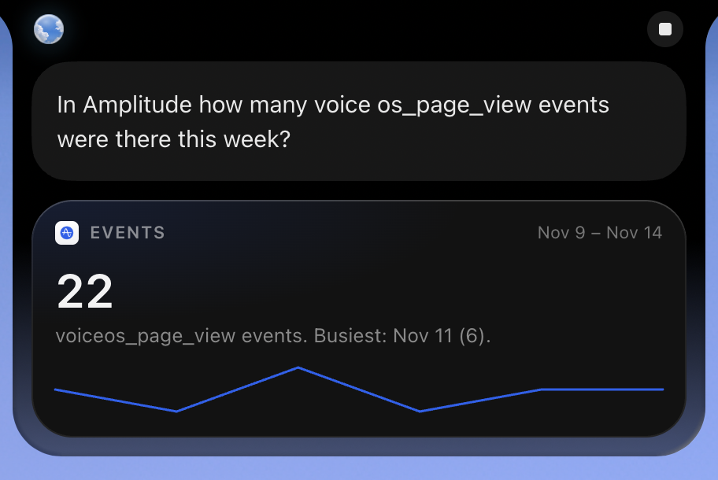
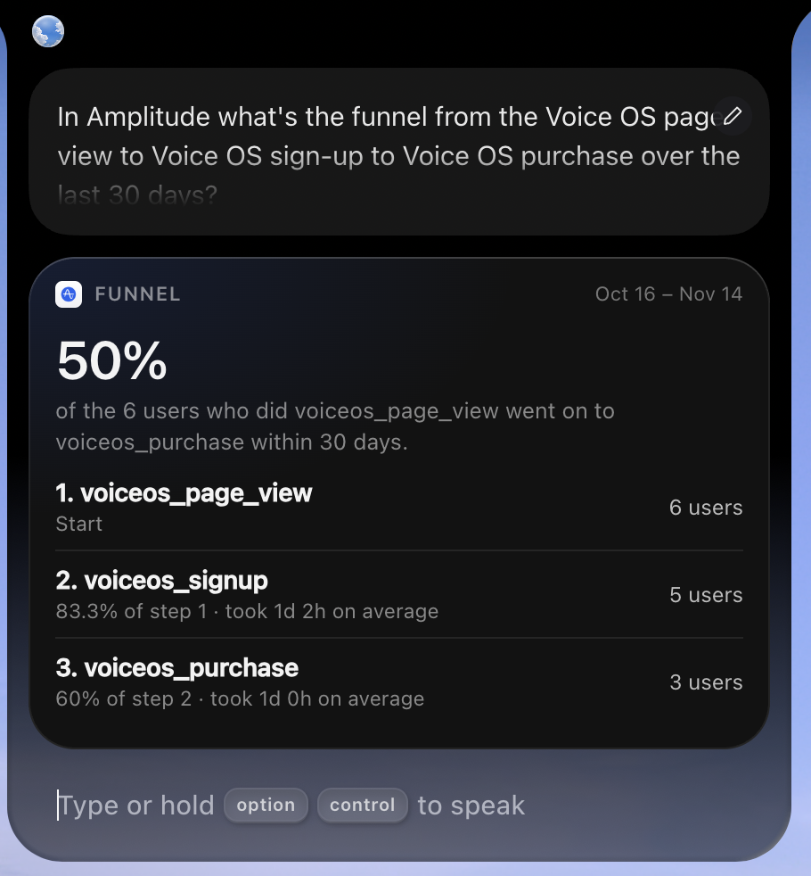
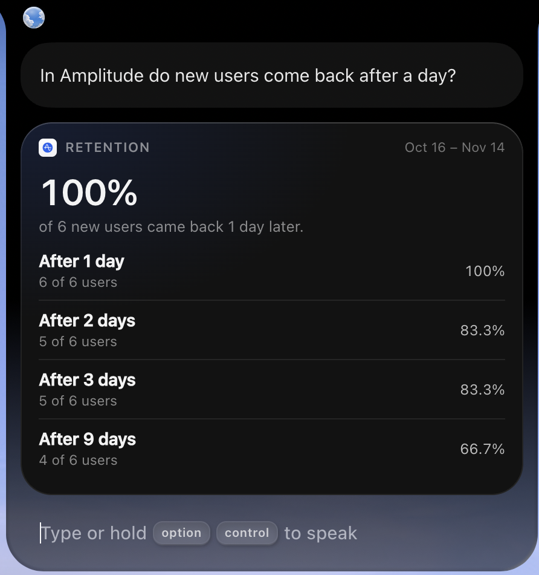
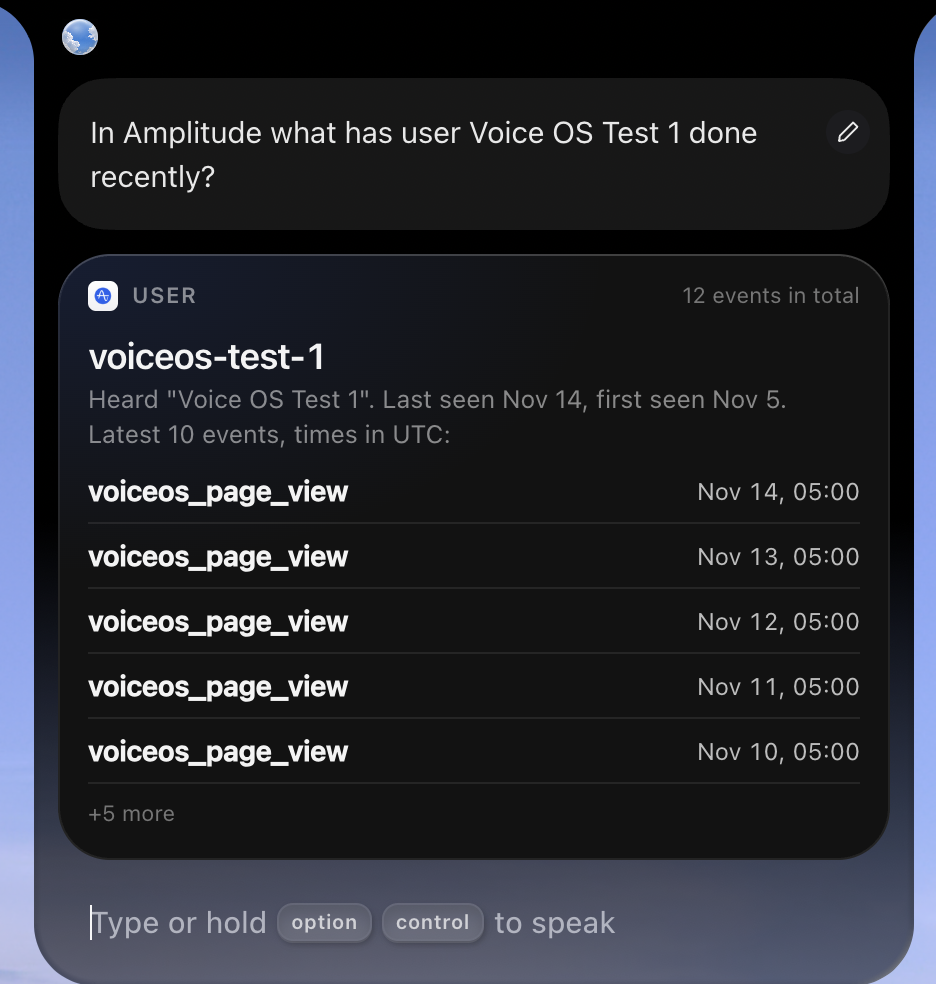
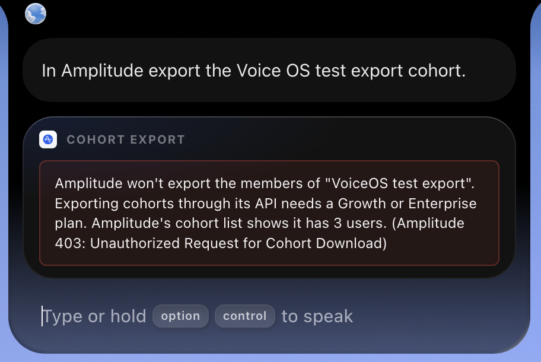

# Amplitude for VoiceOS: handoff

Version 1.0.0 of a VoiceOS integration that lets the voice agent read Amplitude analytics: event trends, funnels, retention, one user's activity, and cohort exports. All Amplitude access goes through Composio's REST API v3.1, using the user's own Amplitude API key and secret key. Every tool is read-only, so none has a confirmation card.

Install link: not published yet; it will be added after review.

## Tools

| Tool | Composio slugs | Notes |
|---|---|---|
| `get_event_segmentation` | `AMPLITUDE_GET_EVENT_SEGMENTATION` | Uniques, totals, % DAU or average; daily, weekly, monthly or 5-minute realtime; optional group-by |
| `get_funnel` | `AMPLITUDE_GET_FUNNEL_DATA` | 2 to 4 steps, checked before any call; ordered, sequential or unordered |
| `get_retention` | `AMPLITUDE_GET_RETENTION` | Start and return events sent as JSON strings, e.g. `{"event_type":"_new"}` |
| `get_user_activity` | `AMPLITUDE_FIND_USER`, then `AMPLITUDE_GET_USER_ACTIVITY` | Finds the Amplitude ID from a user ID or device ID; returns candidates when several users match |
| `export_cohort` | `AMPLITUDE_LIST_COHORTS`, `AMPLITUDE_GET_COHORT`, `AMPLITUDE_CHECK_COHORT_STATUS`, `AMPLITUDE_DOWNLOAD_COHORT_FILE` | Resolves a name to an ID, polls for up to 15s, downloads at once, returns the member count and a 3-row sample |

No other Composio action is called anywhere. `tests/server.test.ts` checks this against an allowlist (`APPROVED_SLUGS`).

**Get dashboard is out of scope.** The ticket listed it, but Composio's Amplitude toolkit has no dashboard or chart action (its 54 actions were checked), so it can't be built on Composio.

## Screenshots

The integration's glance cards in the VoiceOS notch, from v1.0.0 against a test project.

| `get_event_segmentation` | `get_funnel` |
|---|---|
|  |  |

| `get_retention` | `get_user_activity` |
|---|---|
|  |  |

`export_cohort` on a free Amplitude plan, which can't export cohort members:



## Setup

1. Create a Composio API key at platform.composio.dev -> API Keys, in a Platform workspace (not For You).
2. In Amplitude, open Settings -> Projects -> your project -> API keys and copy the API key and the secret key.
3. Install the app in VoiceOS and enter the three keys plus the region (US or EU).

The app creates its Composio auth config (API_KEY scheme) and a connected account on first use. The connected account's field names come from `GET /api/v3.1/toolkits/amplitude`: `full` (the API base URL for the region), `generic_api_key` and `generic_id` (the secret key). To run the server locally, run `bun install`, set the variables in `.env.example` in your environment, and run `bun server.ts`.

## Findings from live testing

These were checked against a real Amplitude project, not taken from the docs.

- **Segmentation interval.** Composio describes `i="1"` as hourly and `"7"` as daily. They're wrong. Live results show `"1"` is daily, `"7"` weekly, `"30"` monthly and `"-300000"` 5-minute realtime, which is Amplitude's own meaning. Composio rejects Amplitude's hourly value `"-3600000"`, so the tool offers daily, weekly, monthly and realtime.
- **Retention mode.** Composio lists `rm="n-day"`, but Amplitude rejects it ("Invalid retention method"). n-day is Amplitude's default when `rm` is left out, so the tool only sends `rm` for rolling.
- **Dictated user IDs.** In a VoiceOS test, dictation turned "voiceos-test-1" into "User Voice OS Test 1". When the exact text finds no one, `get_user_activity` drops a leading "user" and tries up to 16 spellings without spaces (most likely first, 4 at a time). Only exact user or device ID hits count, and the card says what it heard. Live, this found `voiceos-test-1` from that phrase.
- **Unknown events** come back as Amplitude `event_type_not_found`. The tool turns that into "Amplitude has no event named X in this project".
- **Lookback limit.** Amplitude rejects dates older than the plan allows ("Date too far back"; one year on the test plan). The error is passed through as is.
- **Cohorts must be discoverable.** `AMPLITUDE_LIST_COHORTS` only returns cohorts marked discoverable in Amplitude. A private cohort doesn't appear, and the tool says how to make it discoverable.
- **Cohort download needs a paid plan.** On the free test project, `AMPLITUDE_GET_COHORT` returned Amplitude 403 "Unauthorized Request for Cohort Download", even for a discoverable cohort. Calling Amplitude's `/api/5/cohorts/request` directly with the same keys gave the same 403, so the limit is Amplitude's, not Composio's. Amplitude documents cohort downloads for Growth and Enterprise plans.

## Privacy

`get_user_activity` builds its output from an allowlist. IP address, city, region, country, DMA, location, carrier, OS, platform and every device field are left out of the profile, the events, event and user properties, and the candidate list. `export_cohort` drops the same columns from its sample. Keys are redacted from every error and log line.

## Test results

The live run used a test Amplitude project seeded with 46 synthetic events (6 users, 3 event types), sent straight to Amplitude's HTTP API rather than through the integration. Results matched the seed and Amplitude's own query engine. For example, the funnel `voiceos_page_view -> voiceos_signup -> voiceos_purchase` gave 6 -> 5 -> 3 both here and in Amplitude.

| Tool | Normal | Empty | Bad input |
|---|---|---|---|
| `get_event_segmentation` | 38 events in 30 days; 6 users across 5 weeks; grouped by platform | 0 events in a range with no data | Unknown event: clear error; invalid date rejected |
| `get_funnel` | 6 -> 5 -> 3 users | All steps 0 | 1 step and 5 steps rejected before any call |
| `get_retention` | 6 new users, 100% day-1 retention | 0 users | Start after end rejected |
| `get_user_activity` | 12 events, no location or device fields | Unknown user: found false | Limit 0 rejected |
| `export_cohort` | Discoverable cohort listed and resolved by name; download blocked by the plan's 403, shown as a clear error | No cohorts listed (before one was made discoverable) | Unknown cohort and invalid request ID rejected |

The live run passed 23 of 24 checks, with the cohort download skipped because of the plan limit. `bun test` runs 45 offline checks, which also cover export polling, download, CSV sampling and column filtering.

## How to test

`bun test` runs the offline suite in `tests/server.test.ts`. It starts the real server against a fake Composio (`tests/mock-composio.ts`), so it needs no keys or network.

```bash
bun install
bun test
```

`tests/e2e.ts` starts the server through `run.sh`, as VoiceOS does, and calls all 5 tools over MCP against a real Amplitude project. Keys are read from environment variables only. Nothing in the project changes, because every tool is read-only.

```bash
COMPOSIO_API_KEY=... AMPLITUDE_API_KEY=... AMPLITUDE_SECRET_KEY=... \
E2E_EVENTS="Page View,Sign Up" E2E_USER=some-user-id bun tests/e2e.ts
```

`E2E_EVENTS` lists 2 to 4 events in the project, in funnel order, and `E2E_USER` is a user ID or device ID in the project. The optional variables are `AMPLITUDE_REGION` (default `us`), `E2E_USER_PREFIX` (a prefix several users share), `E2E_COHORT` (a discoverable cohort to export), and `E2E_EMPTY_START`/`E2E_EMPTY_END` (a date range with no data; default 60 to 31 days ago). The test exits with a non-zero status if any check fails.

## Known limitations

- Windows is listed as supported and uses the same generated `run.cmd` launcher as the other integrations, but it hasn't been run on Windows yet.
- The EU region sets the EU API base URL on the connected account, but it hasn't been tested against an EU project.
- Composio offers no hourly segmentation (see above).
- **The cohort file download is untested live**, because it needs a paid plan (see above). The server fetches the file from a short-lived link Composio returns, on a storage host other than `backend.composio.dev` that hasn't been seen yet. If VoiceOS enforces `permissions.domains`, add that host once it's confirmed on a paid project, as OneDrive does for Composio's file storage; don't guess it. Until then, a failed fetch still returns the cohort's listed size and says the sample is missing.
- Some VoiceOS builds don't re-read a changed manifest after install. See `AGENTS.md` for how to load one.
