# Live Mac screenshots

See [test report](../TESTING.md) for tested scenarios and limits. Click any image for full size.

### Upcoming bookings

[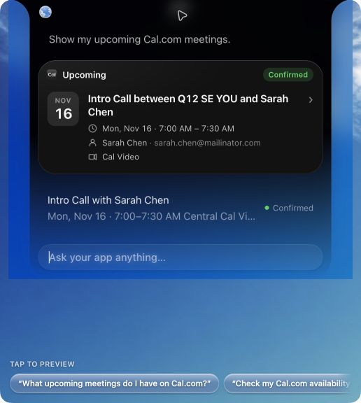](01-get-bookings.jpg)

### Available slots

[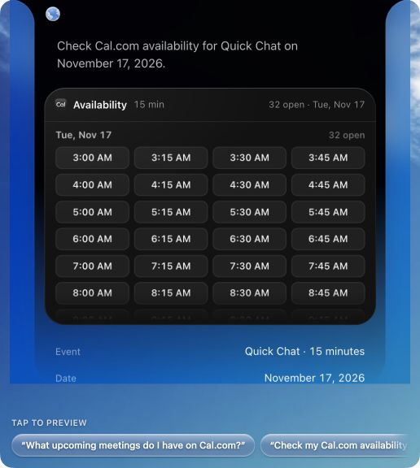](02-availability.jpg)

### Create event type — confirmation

[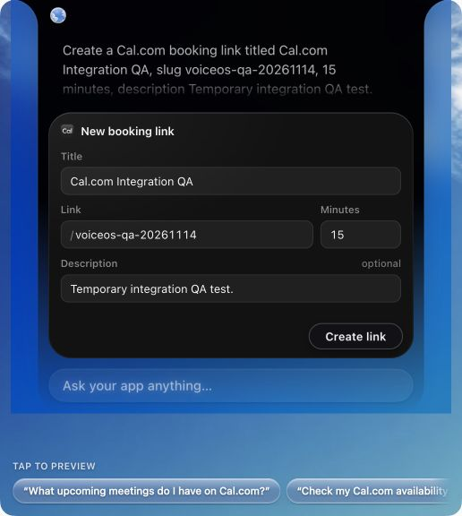](03-create-event-type-confirmation.jpg)

### Create event type — success

[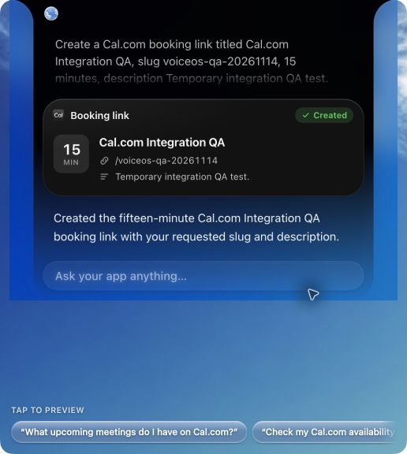](04-create-event-type-success.jpg)

### Create booking — reserved-email confirmation

[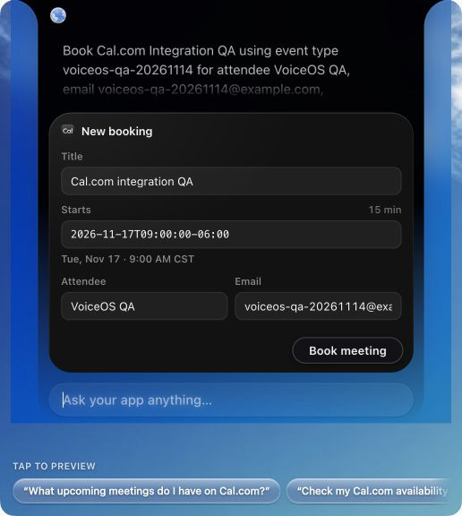](05-create-booking-confirmation.jpg)

### Invalid email — handled error

[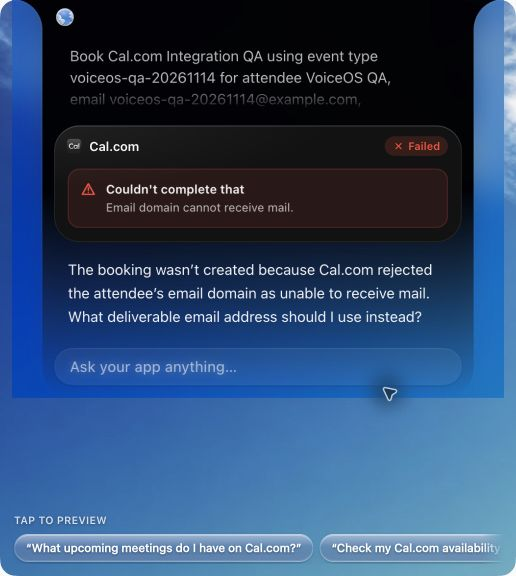](06-create-booking-invalid-email.jpg)

### Create booking — confirmation

### Create booking — success

[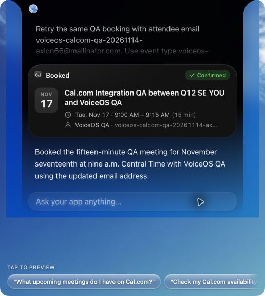](08-create-booking-success.jpg)

### Reschedule — confirmation

[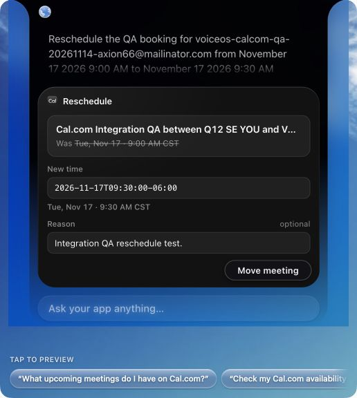](09-reschedule-confirmation.jpg)

### Reschedule — success

[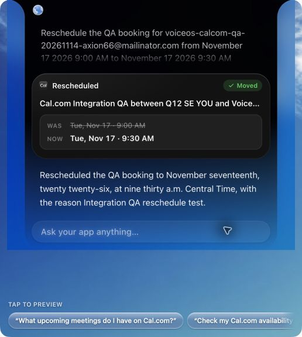](10-reschedule-success.jpg)

### Reschedule — verified details

[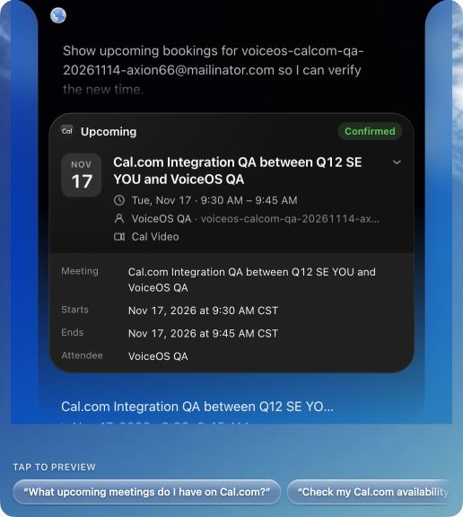](11-reschedule-verified-details.jpg)

### Cancel — confirmation

[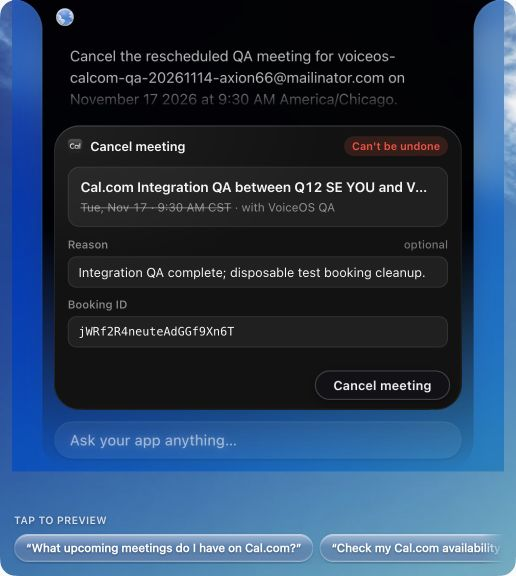](12-cancel-confirmation.jpg)

### Cancel — success

[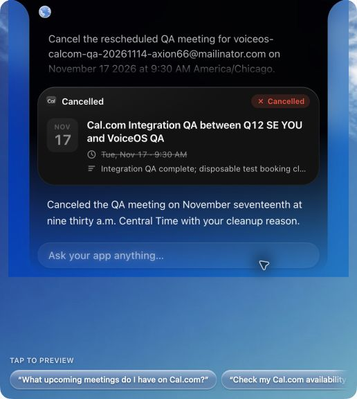](13-cancel-success.jpg)

### First cleanup — no upcoming QA bookings

[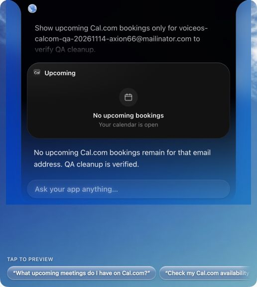](14-cleanup-verified.jpg)

### Event types — list

[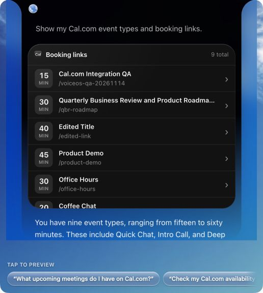](15-get-event-types.jpg)

### Event types — expanded link

[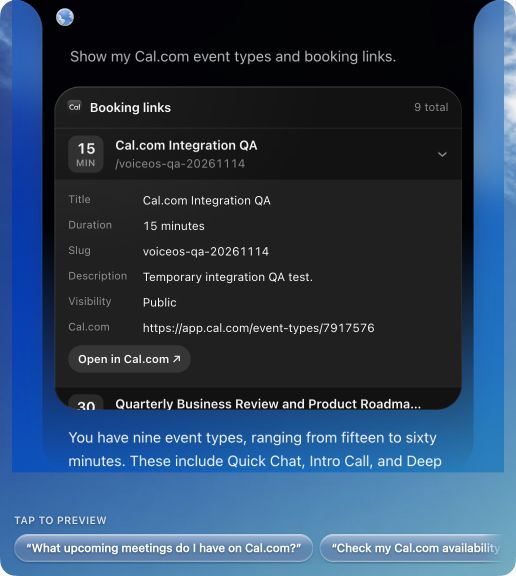](16-event-type-details.jpg)

### Spring DST date — live availability (no slots)

[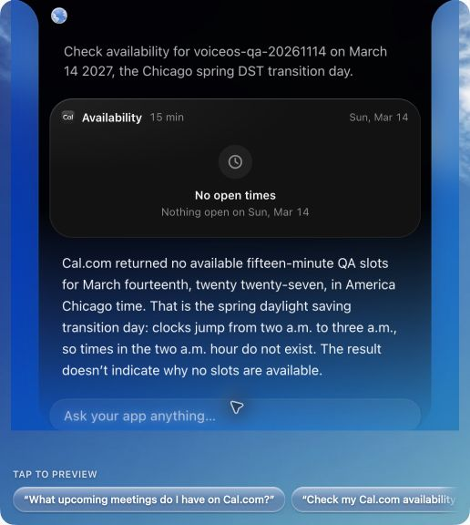](17-spring-dst.jpg)

### Fall DST date — live availability (no slots)

[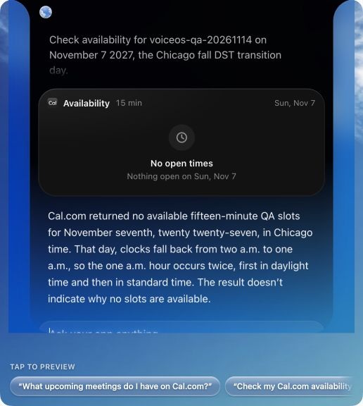](18-fall-dst.jpg)

### Tokyo to Chicago — confirmation

[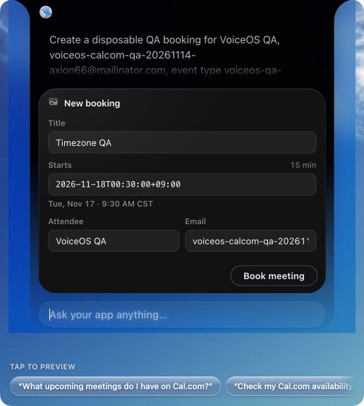](19-tokyo-chicago-confirmation.jpg)

### Tokyo to Chicago — booking success

[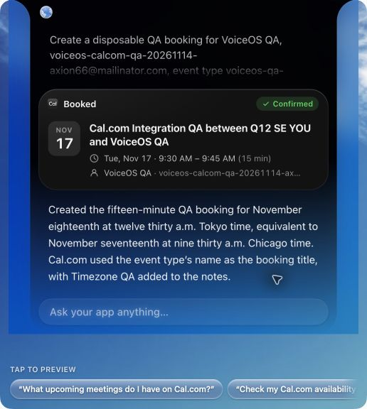](20-tokyo-chicago-success.jpg)

### Occupied slot — rejected

[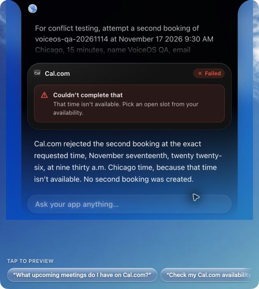](21-conflicting-slot-rejected.jpg)

### Missing offset / DST input — blocked

[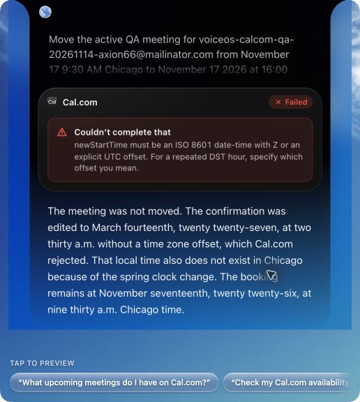](22-dst-missing-offset-blocked.jpg)

### UTC reschedule — confirmation

[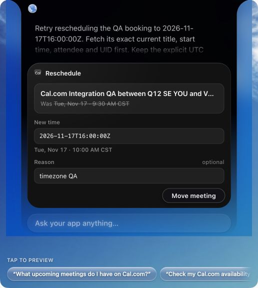](23-utc-reschedule-confirmation.jpg)

### Explicit-link duration mismatch — blocked

[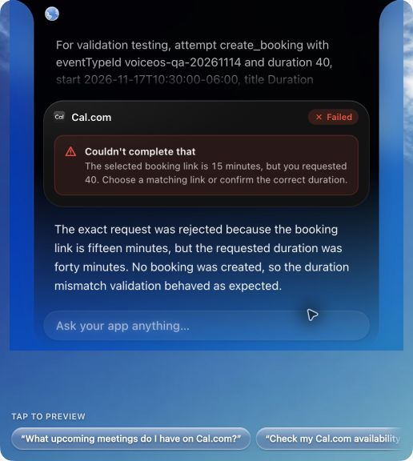](25-duration-mismatch-blocked.jpg)

### Guarded cancellation — confirmation

[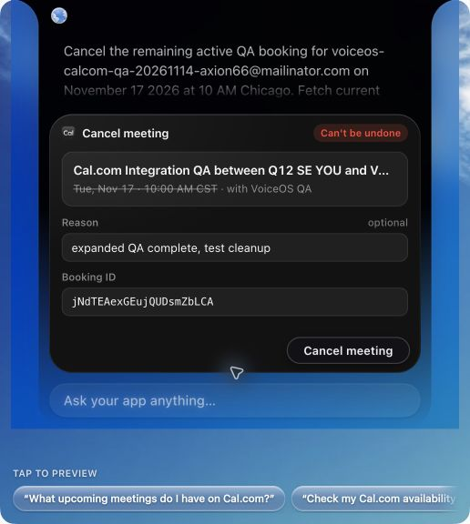](26-guarded-cancel-confirmation.jpg)

### Guarded cancellation — success

[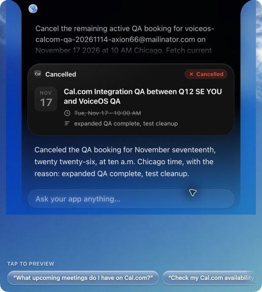](27-guarded-cancel-success.jpg)

### Final cleanup — no upcoming QA bookings

[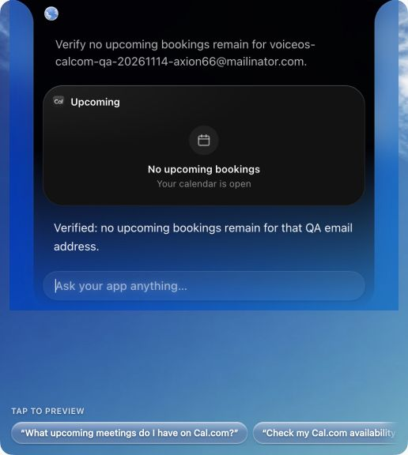](28-final-cleanup-verified.jpg)
