# Manual VoiceOS screenshots - November 13, 2026

Author-supplied originals, ordered by workflow. All six native confirmations show Cancel and Confirm. Cancel responses are visible, but screenshots alone do not prove that provider data stayed unchanged. The latest append footer is visible. No VoiceOS UI was controlled by the coding agent. Older November 8 captures remain historical.

## 01 get-workbook

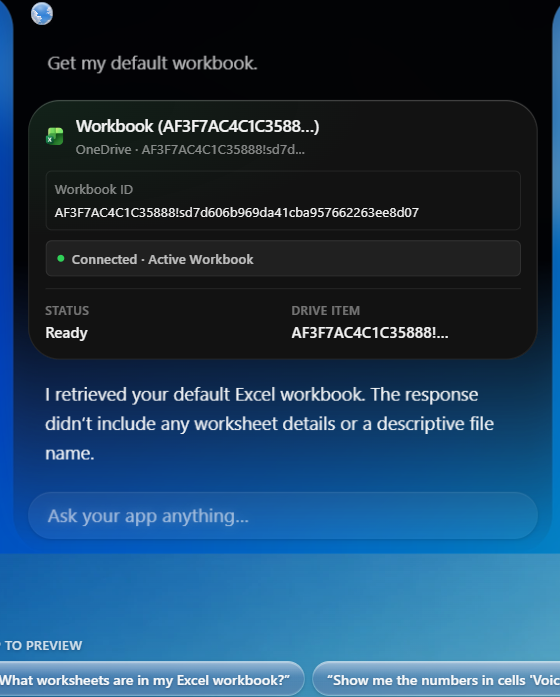

## 02 list-worksheets

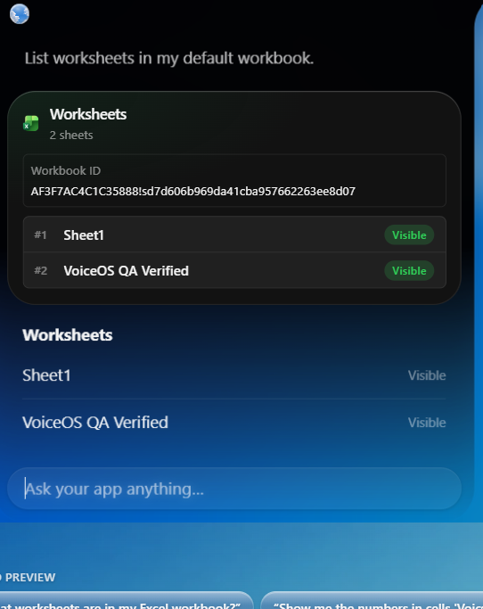

## 03 get-worksheet

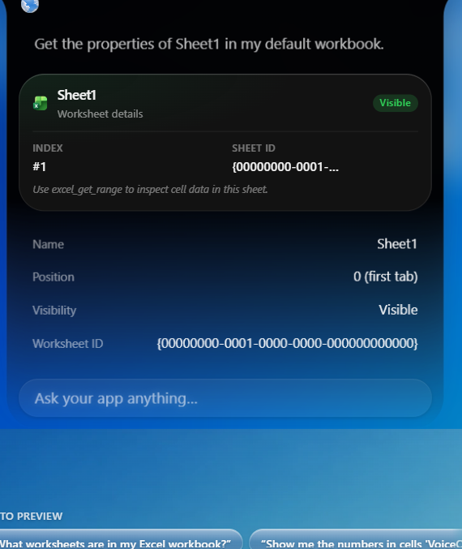

## 04 create-confirmation

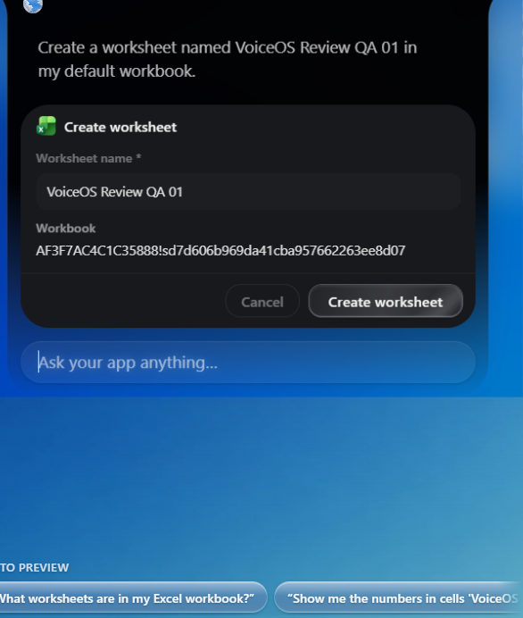

## 05 create-cancelled

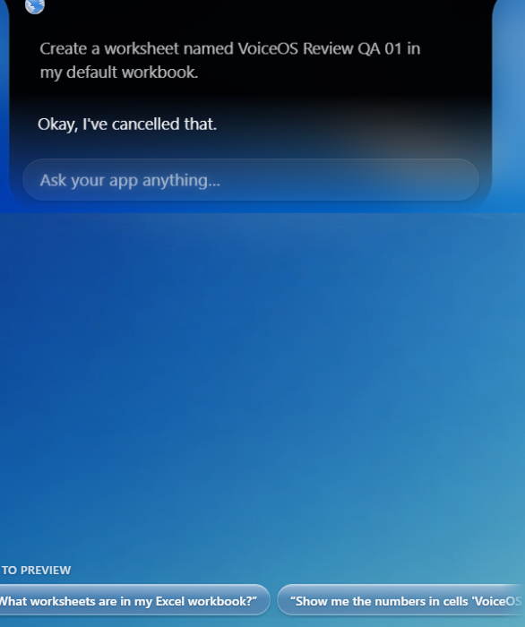

## 06 create-result

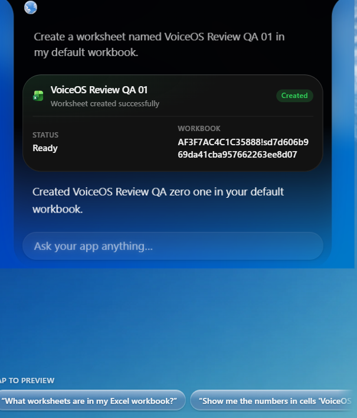

## 07 update-confirmation

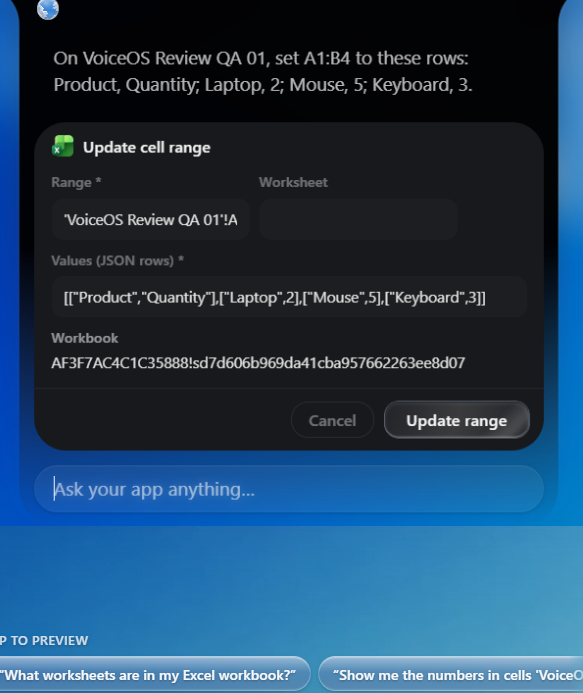

## 08 update-cancelled

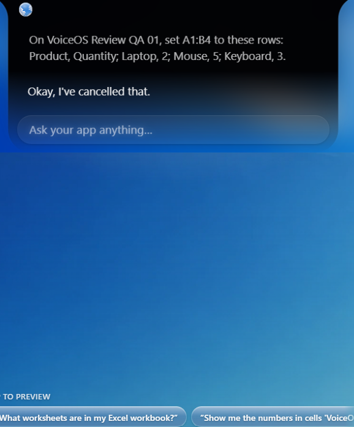

## 09 update-result

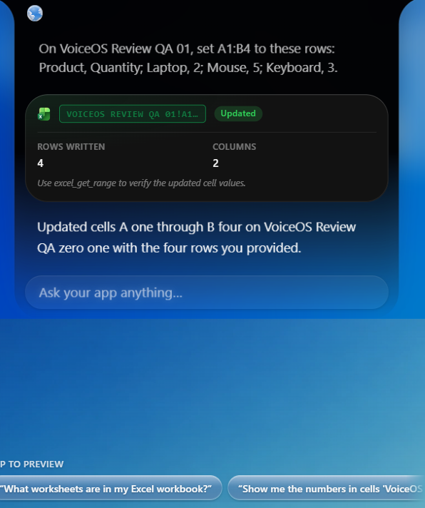

## 10 read-range

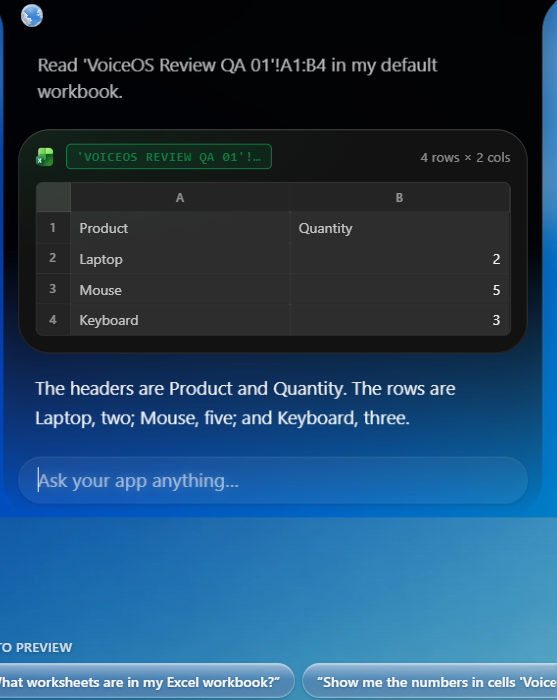

## 11 rename-confirmation

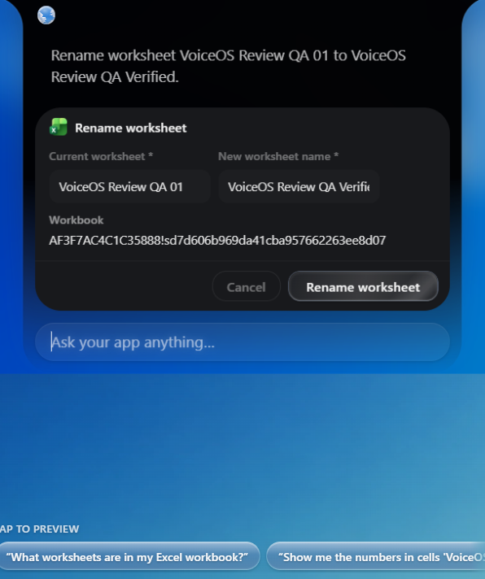

## 12 rename-cancelled

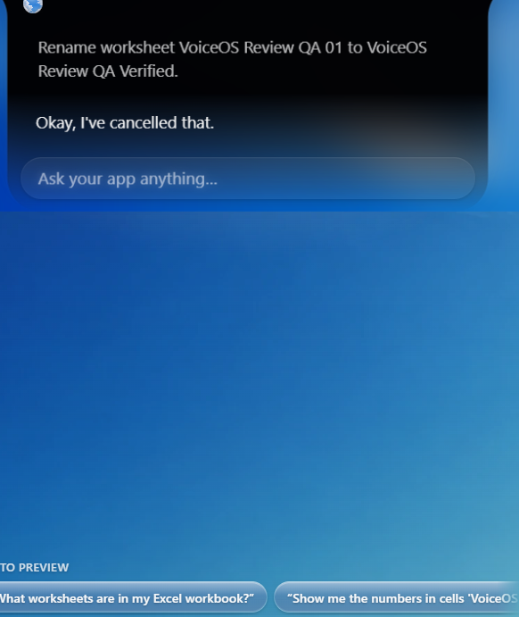

## 13 rename-result

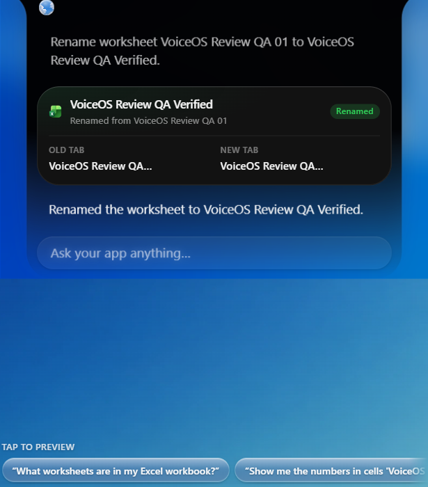

## 14 append-confirmation

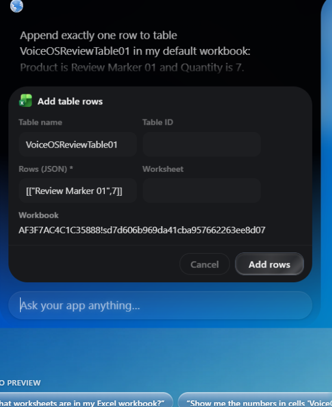

## 15 append-cancelled

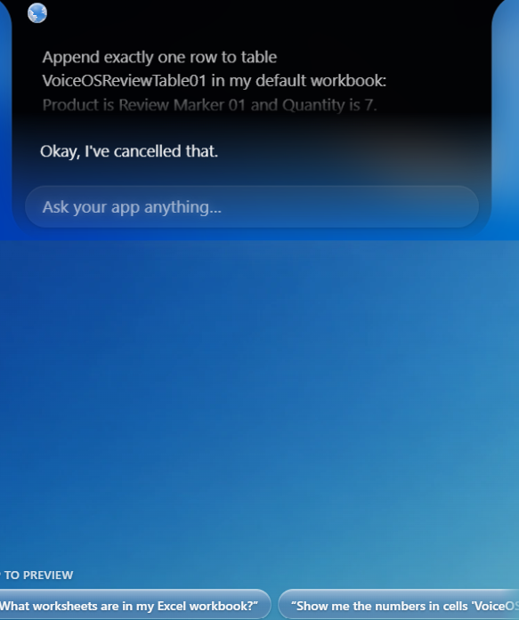

## 16 append-result

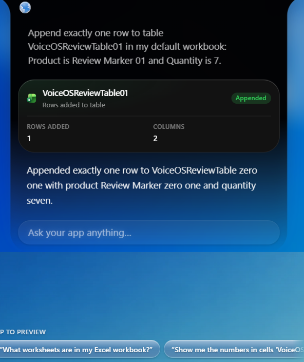

## 17 chart-confirmation

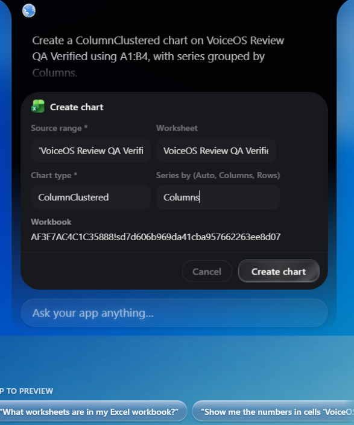

## 18 chart-cancelled

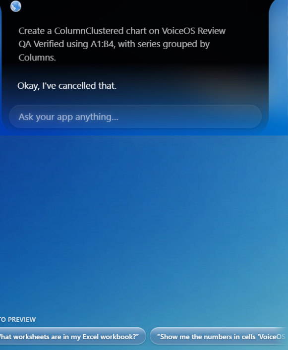

## 19 chart-result

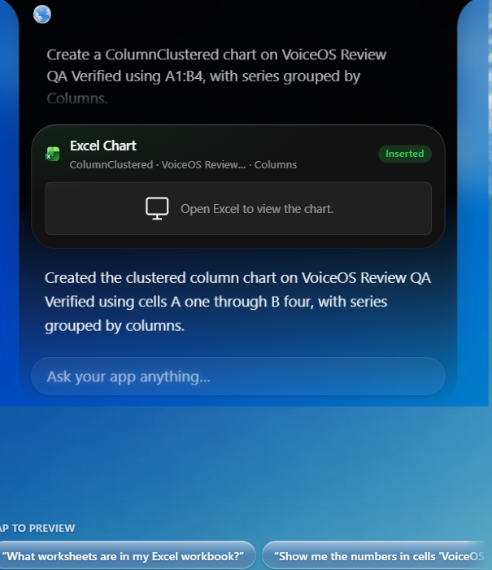

## 20 delete-confirmation

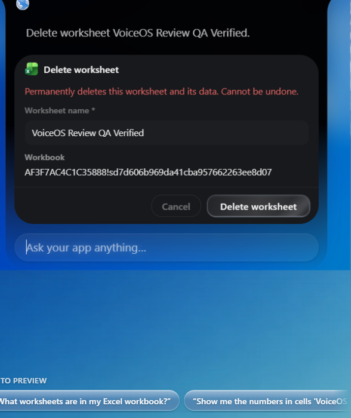

## 21 delete-cancelled

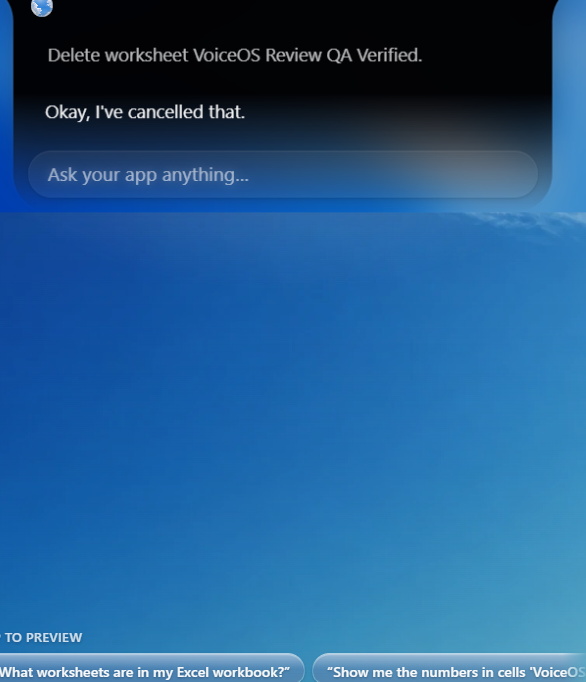

## 22 delete-result

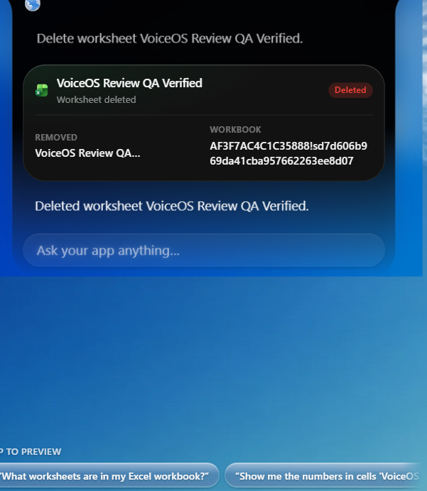
