# Author VoiceOS screenshots — November 16, 2026

Original screenshots copied without editing. Screenshots 07 and 17 replace the older review examples: A1:B4 is fully visible and the worksheet is separate. Cancel and Confirm are visible.

## 07-update-confirmation

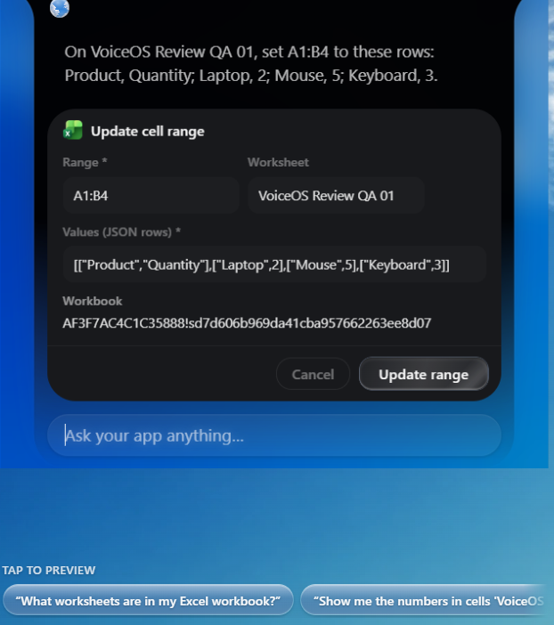

## 08-update-cancel

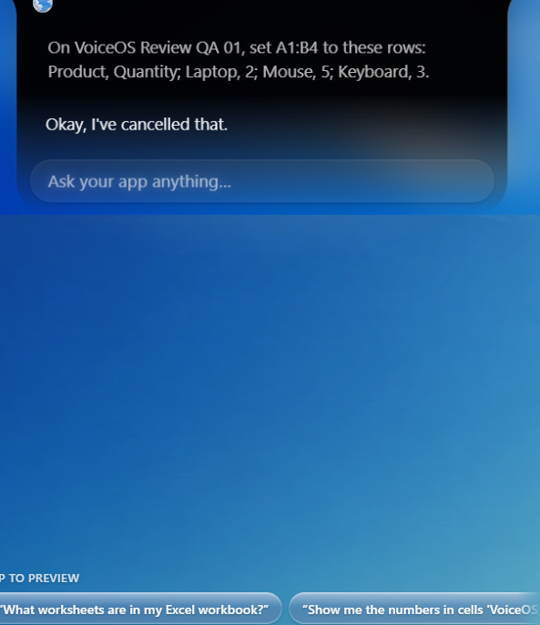

## 09-update-result

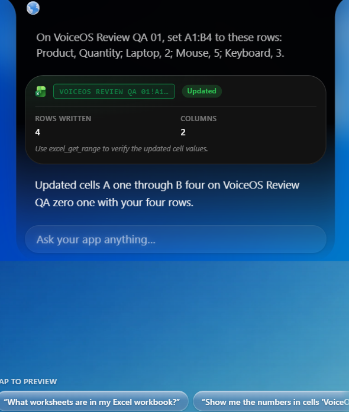

## 10-range-readback

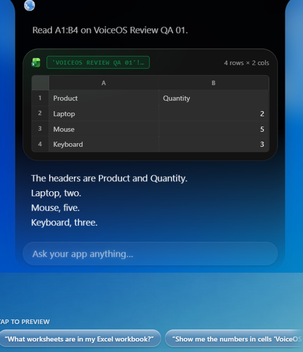

## 11-valid-values-confirmation

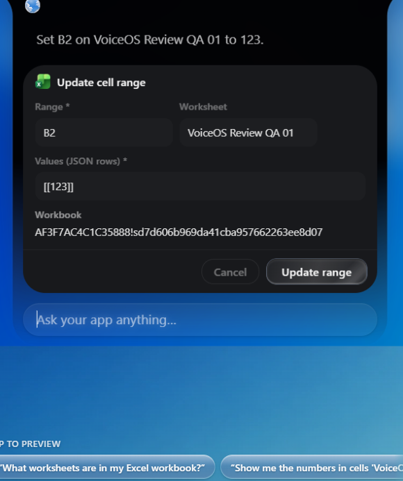

## 12-valid-values-result

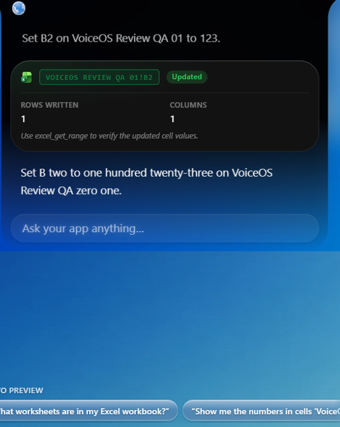

## 13-empty-values-confirmation

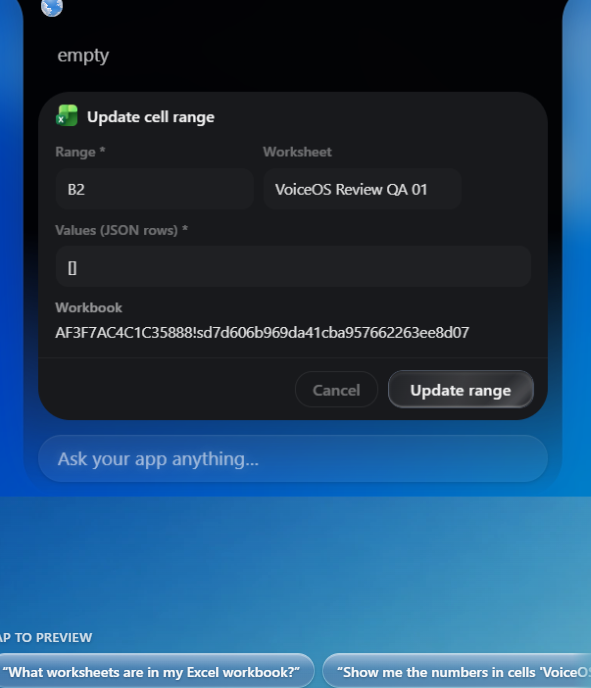

## 14-empty-values-rejected

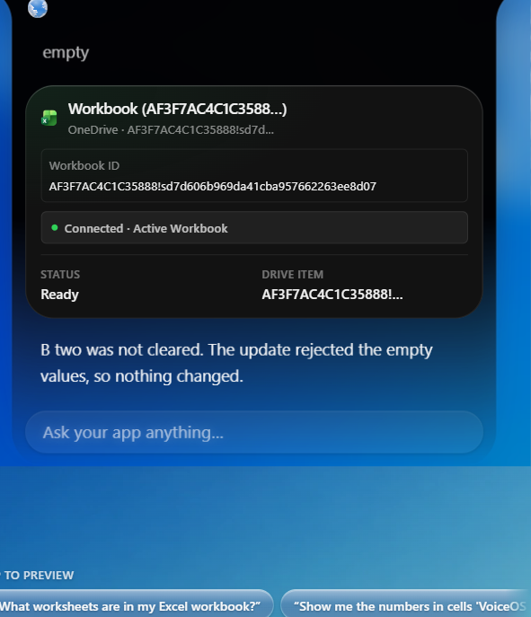

## 17-chart-confirmation

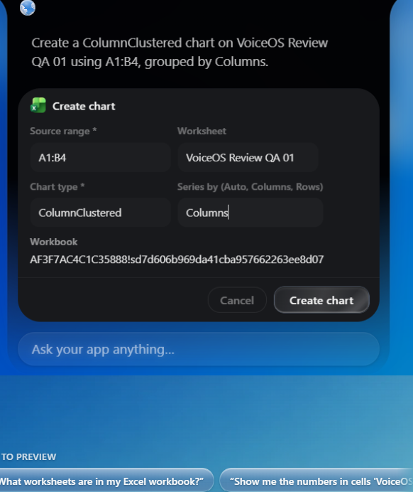

## 18-provider-chart-name

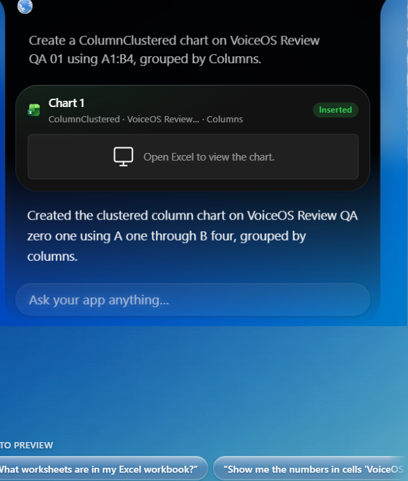

## 19-malformed-json-confirmation

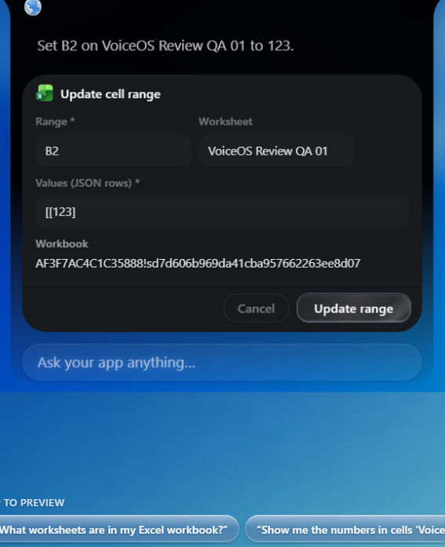

## 20-malformed-json-rejected

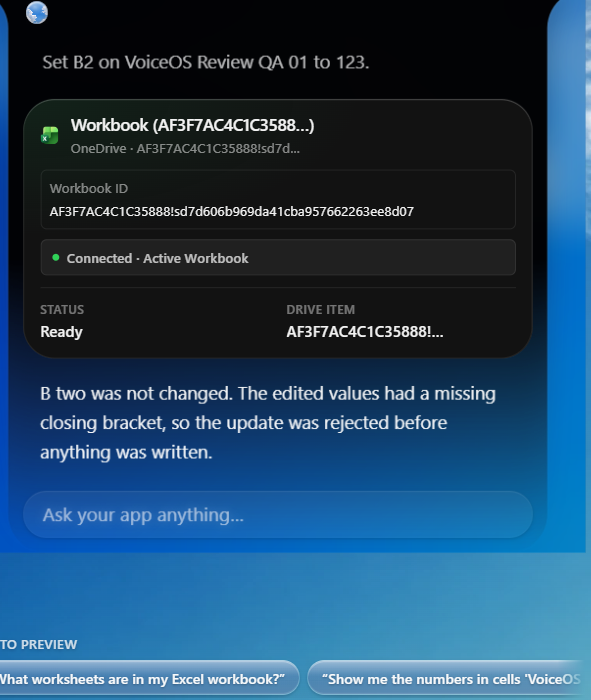

## 21-list-worksheets

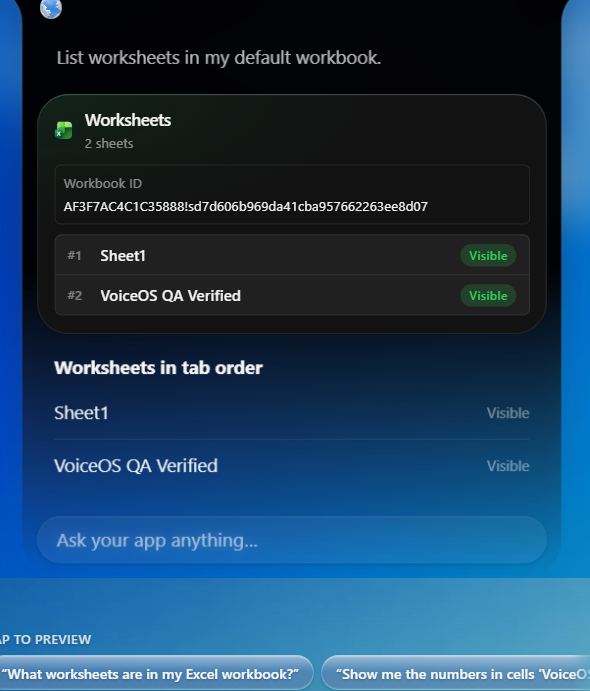

The worksheet-list screenshot shows two sheets; the separate 11:05 log lists three. These are different snapshots, not evidence of the same inventory. Empty/malformed rejection screenshots show narration with a workbook card; the attached execution log confirms isError and no write attempted.
