# VoiceOS UI: fresh live QA

Original screenshots supplied by Prerak from November 1, 2026. They show all ten action results, including the six write results, and three confirmation cards. All six write tools ask the user to click the action button to confirm before execution. Read tools do not require confirmation.

The chart screenshot is the VoiceOS result card, not a rendering of the chart inside Excel. Workbook cards contain truncated test-workbook identifiers; no API keys or OAuth tokens are shown.

### Get workbook

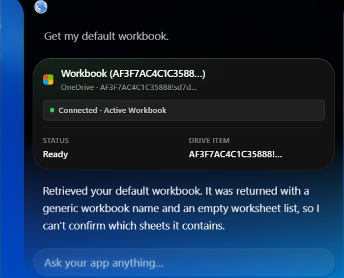

### List worksheets

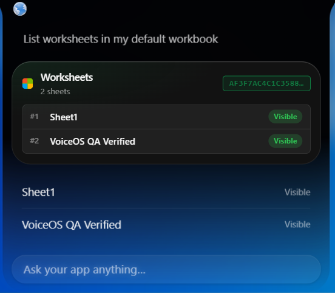

### Get worksheet

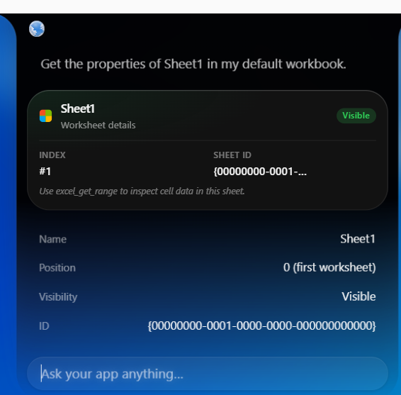

### Create worksheet confirmation

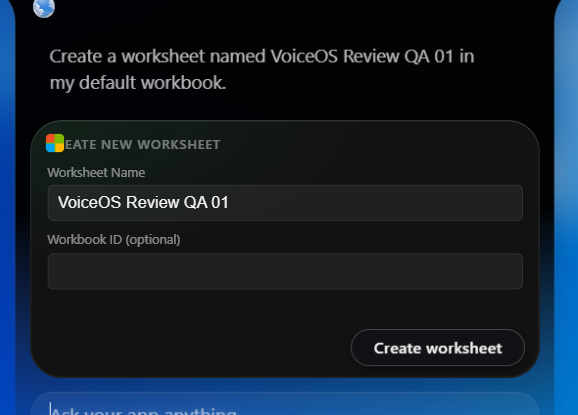

### Create worksheet result

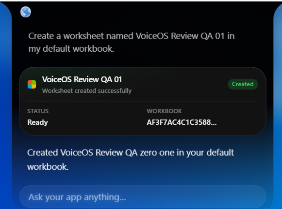

### Update range confirmation

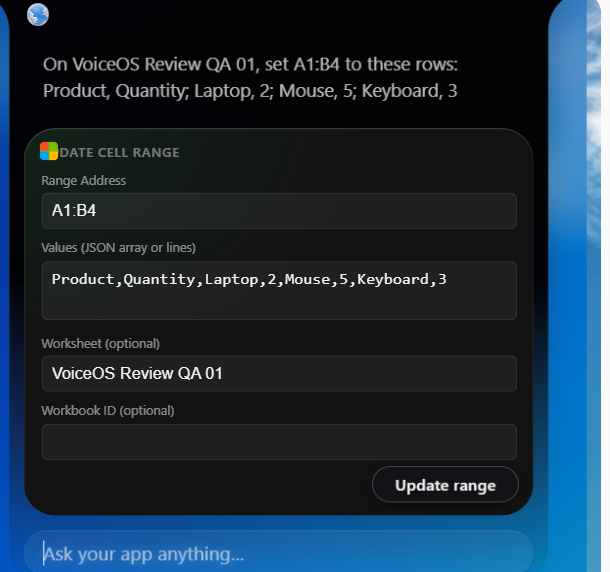

### Update range result

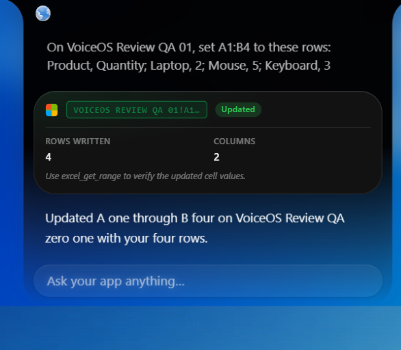

### Read cell range

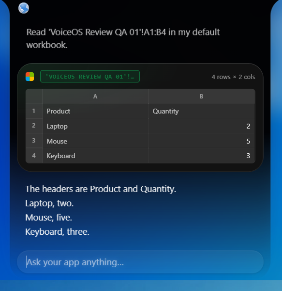

### Rename worksheet result

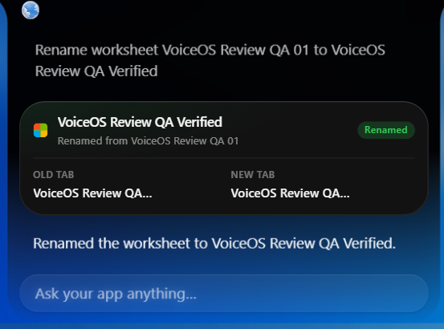

### Append table rows result

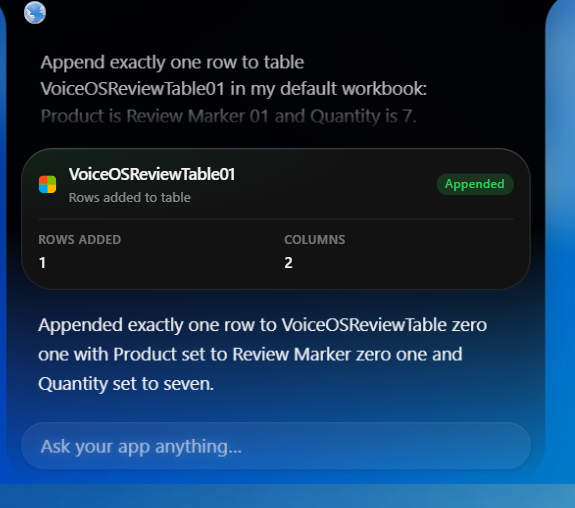

### Create chart result

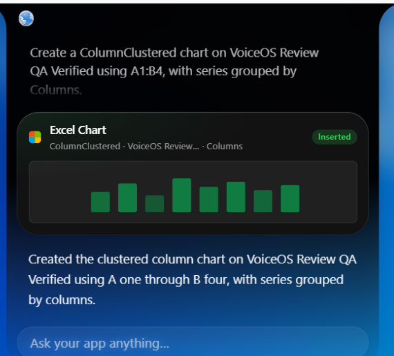

### Delete worksheet confirmation

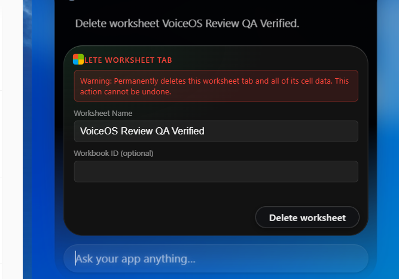

### Delete worksheet result

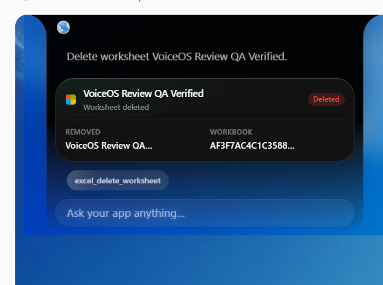
