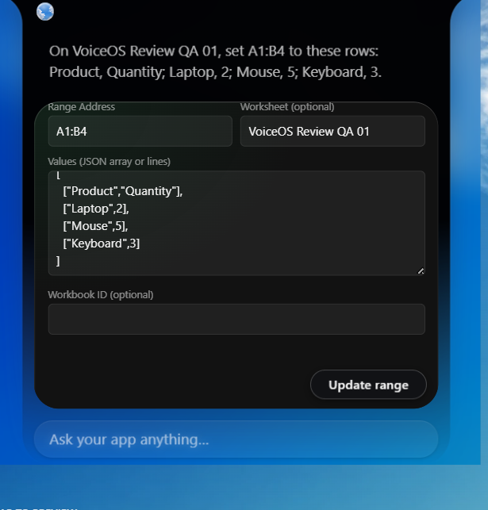
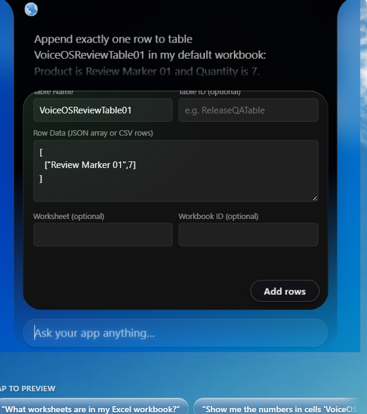
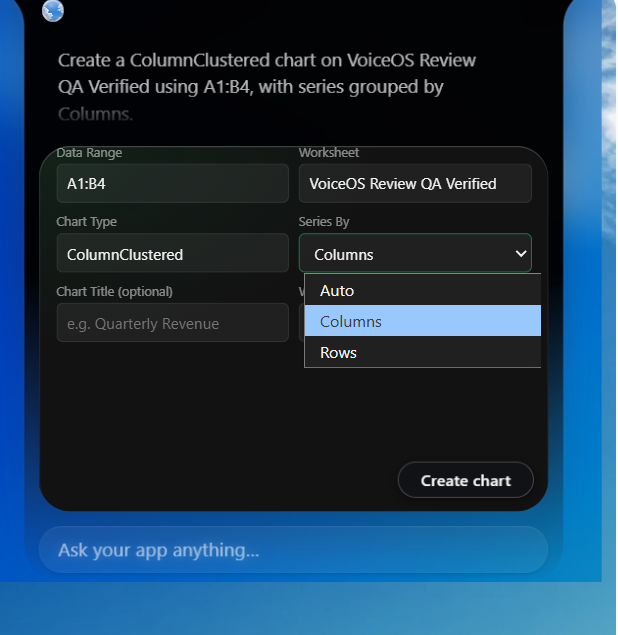

# VoiceOS UI evidence - November 6, 2026

Final author-supplied captures for version 1.0.4, build
excel-review-fixed-v9-footer-layout. All images on this page were taken today
(November 6); none is a historical November 4 capture. Original files were
copied unchanged; repeated uploads/near-duplicate states are omitted.

Steps 01-16 show the workflow, with confirmation before result. All six write
confirmation cards require a user click on the action button. Table Name,
chart Worksheet, and Series By are visible. Matrix values retain JSON row
boundaries. Supplemental views 17-19 show lower fields reachable by scrolling,
a clear gap above the floating button, and readable Auto/Columns/Rows options.
The blank optional workbook fields use the configured default workbook.

Some fields are intentionally below the bounded scrolling form in the initial
view; the supplemental views show access without placing them under the button.
The chart creation result uses a neutral icon. The separate bars below Read
Range are VoiceOS's narration/visualization of the returned values 2, 5, 3,
not a fabricated preview embedded in the integration's chart result card.

These are manual author screenshots, not agent-operated live tests or raw
provider traces. Original Pictures files remain untouched.

## 01. Get workbook

Source: Screenshot 2026-11-06 122411.png.

## 02. List worksheets

Source: Screenshot 2026-11-06 122503.png.

## 03. Get worksheet

Source: Screenshot 2026-11-06 122533.png.

## 04. Create worksheet confirmation

Source: Screenshot 2026-11-06 122550.png.

## 05. Create worksheet result

Source: Screenshot 2026-11-06 122602.png.

## 06. Update range confirmation

Source: Screenshot 2026-11-06 122632.png.

## 07. Update range result

Source: Screenshot 2026-11-06 122653.png.

## 08. Read range result

Source: Screenshot 2026-11-06 122728.png.

## 09. Rename worksheet confirmation

Source: Screenshot 2026-11-06 122844.png.

## 10. Rename worksheet result

Source: Screenshot 2026-11-06 122854.png.

## 11. Append rows confirmation

Source: Screenshot 2026-11-06 122947.png.

## 12. Append rows result

Source: Screenshot 2026-11-06 123022.png.

## 13. Chart confirmation

Source: Screenshot 2026-11-06 123056.png.

## 14. Chart result

Source: Screenshot 2026-11-06 123126.png.

## 15. Delete worksheet confirmation

Source: Screenshot 2026-11-06 123150.png.

## 16. Delete worksheet result

Source: Screenshot 2026-11-06 123207.png.

## 17. Update range scrolled to lower fields

Source: Screenshot 2026-11-06 122641.png.

## 18. Append rows scrolled to lower fields

Source: Screenshot 2026-11-06 122957.png.

## 19. Chart grouping options and lower fields

Source: Screenshot 2026-11-06 123109.png.

