# VoiceOS UI evidence ? November 8, 2026

These are author-supplied manual screenshots, copied unchanged from the November 8 final sequence. No VoiceOS window was opened or controlled by the agent. Repeated uploads and superseded intermediate states are omitted.

The 16 images show all ten action results and all six write confirmations, in workflow order. Append displays Table Name; chart displays Worksheet and Series By. Matrix rows remain separate JSON rows. Overflowing confirmations have visible scrollbars; short forms have no forced scrollbar. A noninteractive black footer sits behind the host confirmation button. All write actions require clicking that button. Blank optional workbook fields use the configured default.

These captures demonstrate manual UI behavior, not a new raw provider transcript or proof that the latest source has been republished. The separate chart below the range card is VoiceOS narration using returned data, not a synthetic chart-result preview.

## 01 get workbook

Source: Screenshot 2026-11-08 214711.png

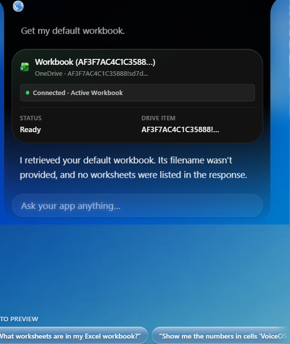

## 02 list worksheets

Source: Screenshot 2026-11-08 214753.png

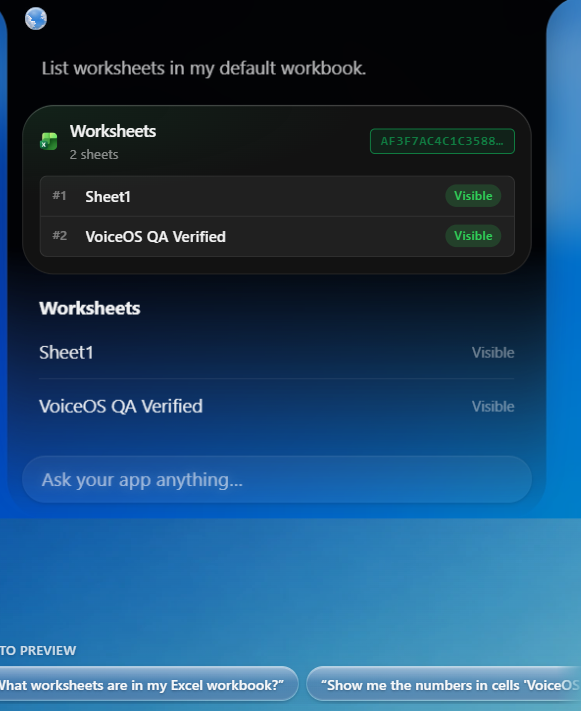

## 03 get worksheet

Source: Screenshot 2026-11-08 214812.png

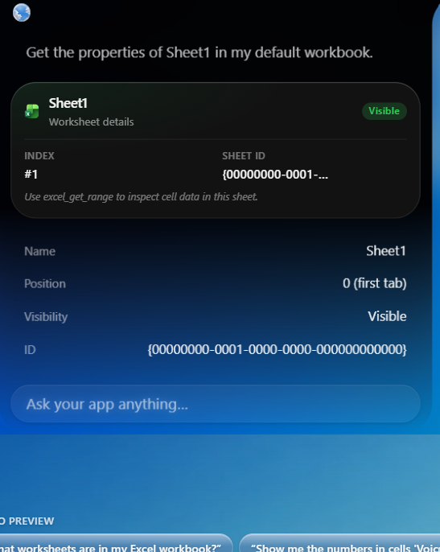

## 04 create worksheet confirmation

Source: Screenshot 2026-11-08 214831.png

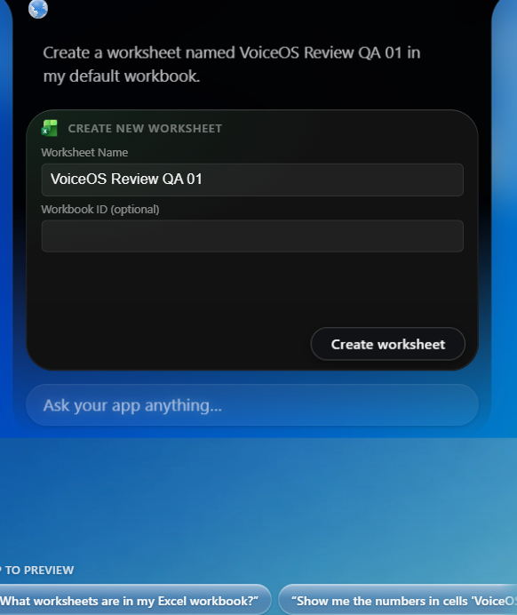

## 05 create worksheet result

Source: Screenshot 2026-11-08 214846.png

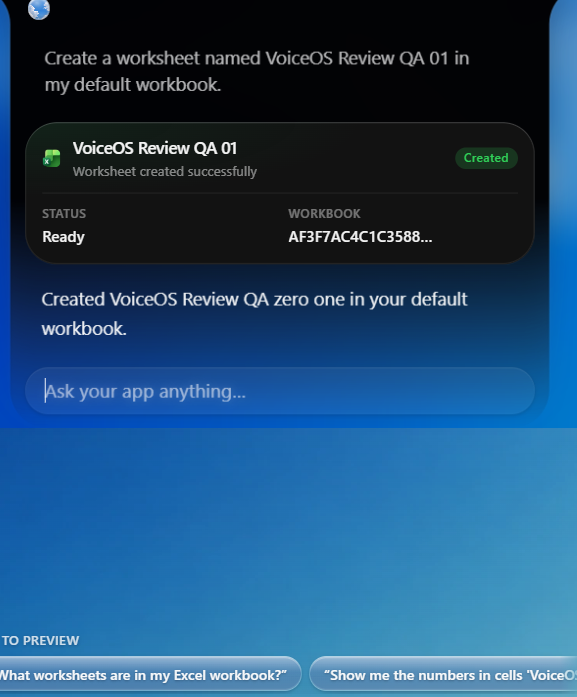

## 06 update range confirmation

Source: Screenshot 2026-11-08 214908.png

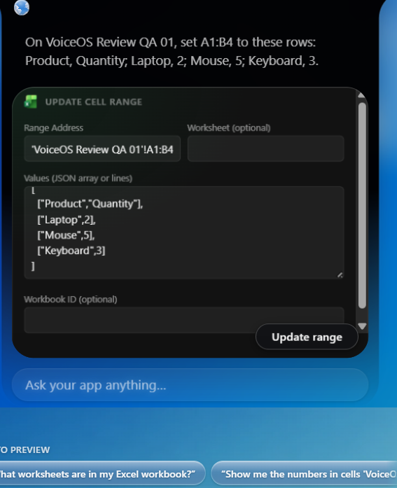

## 07 update range result

Source: Screenshot 2026-11-08 214921.png

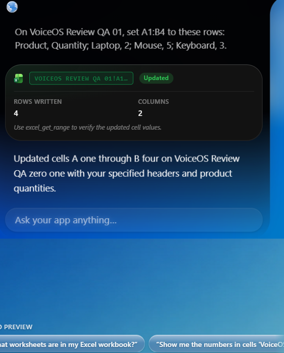

## 08 get range

Source: Screenshot 2026-11-08 214942.png

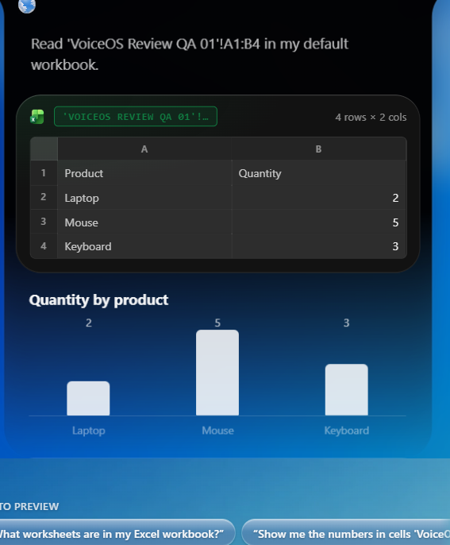

## 09 rename worksheet confirmation

Source: Screenshot 2026-11-08 215000.png

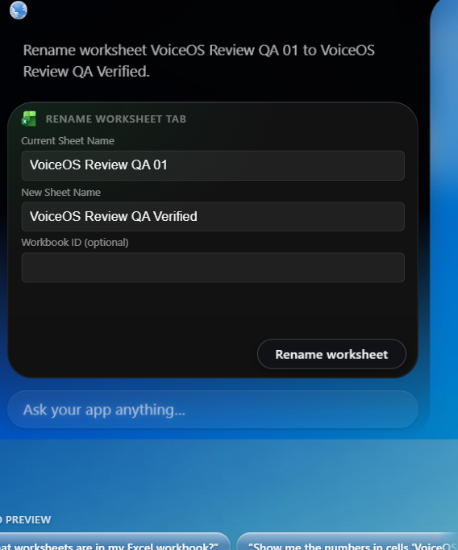

## 10 rename worksheet result

Source: Screenshot 2026-11-08 215013.png

## 11 append rows confirmation

Source: Screenshot 2026-11-08 215119.png

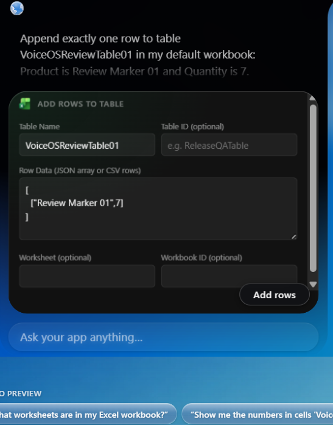

## 12 append rows result

Source: Screenshot 2026-11-08 215132.png

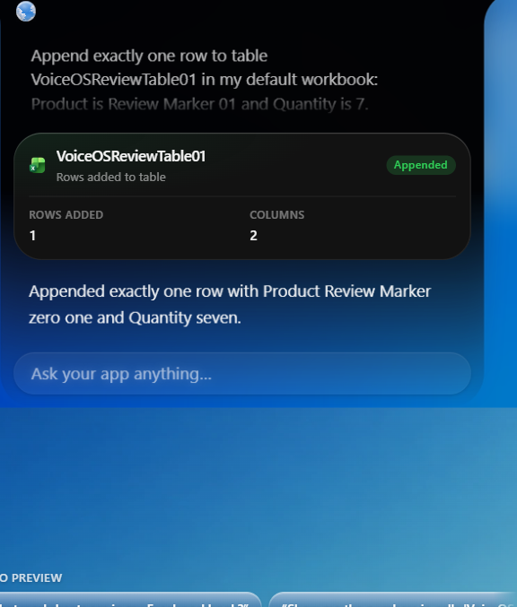

## 13 create chart confirmation

Source: Screenshot 2026-11-08 215155.png

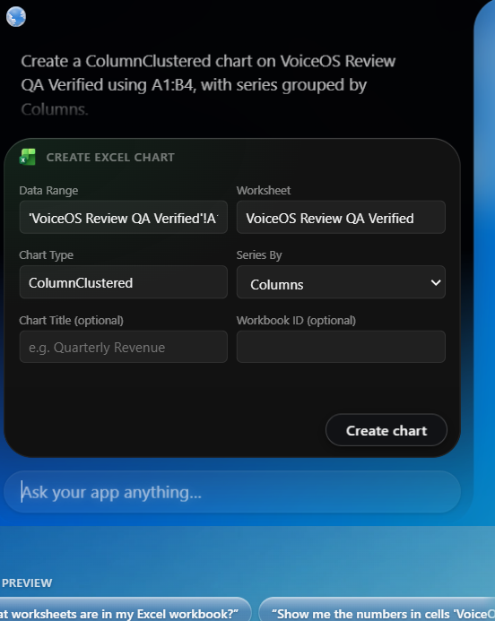

## 14 create chart result

Source: Screenshot 2026-11-08 215205.png

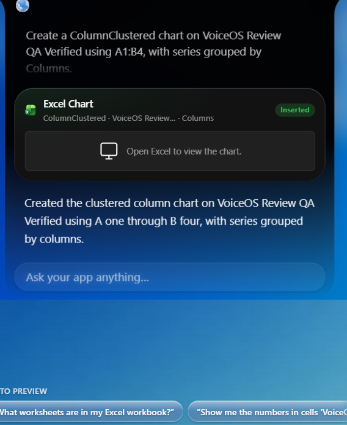

## 15 delete worksheet confirmation

Source: Screenshot 2026-11-08 215229.png

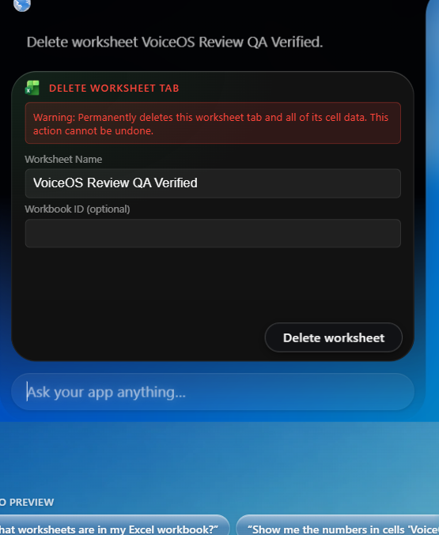

## 16 delete worksheet result

Source: Screenshot 2026-11-08 215241.png

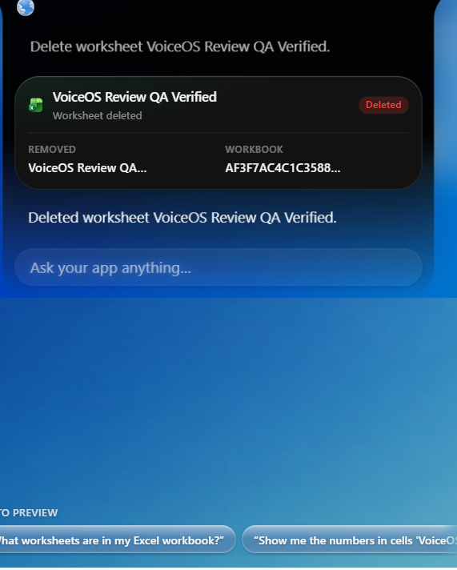
