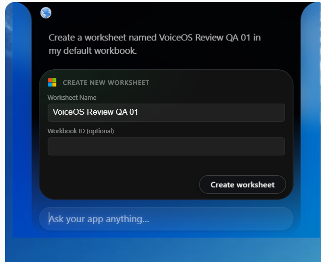
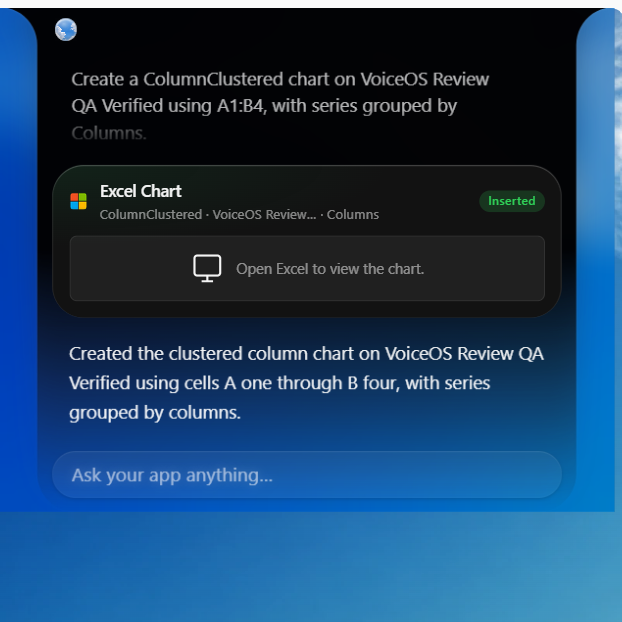
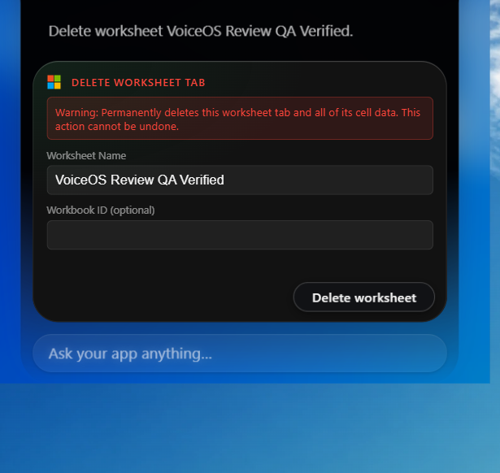

# UI review fixes — November 3, 2026

Build: `excel-review-fixed-v7-inline-brand`.

All six write confirmation headers place the official Microsoft symbol and title in a flex row, removing the absolute icon overlay. The chart result uses a neutral icon and tells users to open Excel; it does not fabricate source-data bars. Logo provenance is in ICON-SOURCE.md.

All six write tools require the user to click the confirmation action button before execution. The author supplied these three screenshots from manual VoiceOS testing. The agent did not open or test VoiceOS. Offline validation: 139 tests passed, including all six confirmation layouts. These three screenshots do not independently establish visual testing of the other four confirmation cards.

The other screenshots in this directory are historical November 1 evidence and predate these UI fixes.
