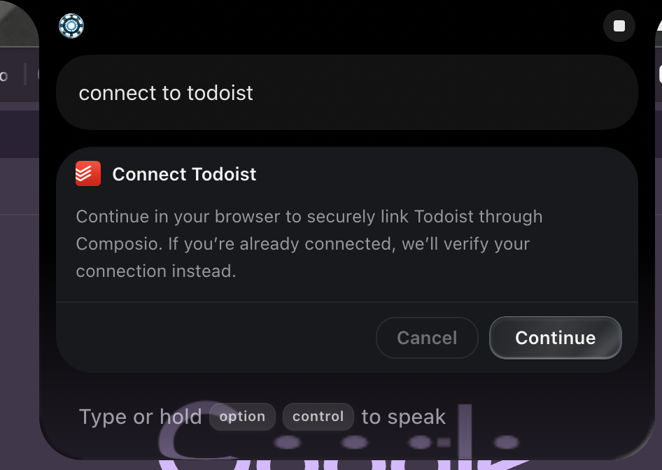
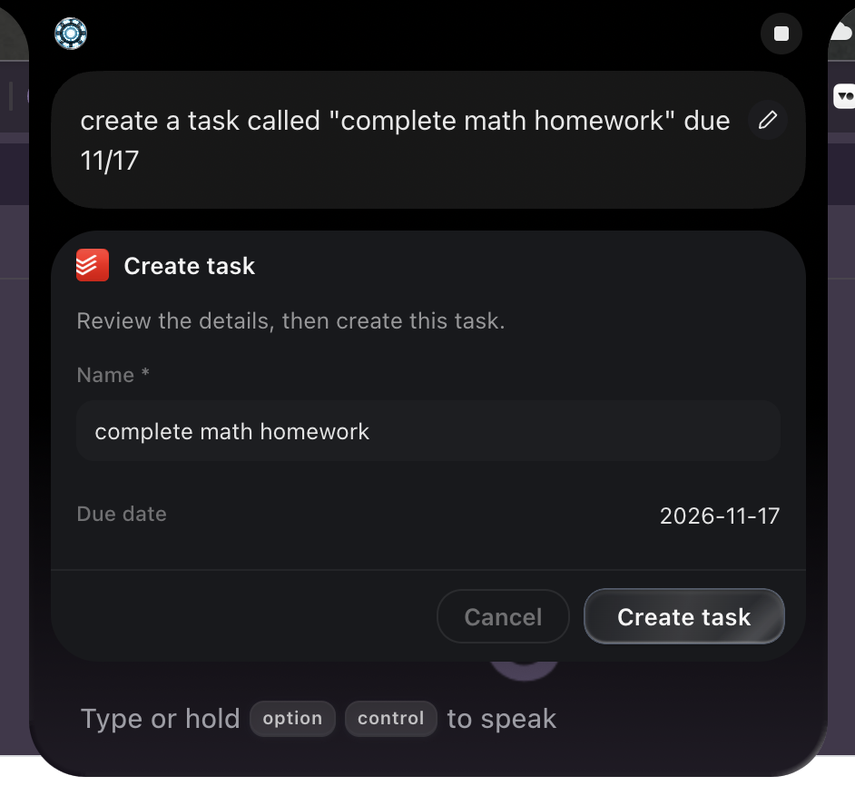
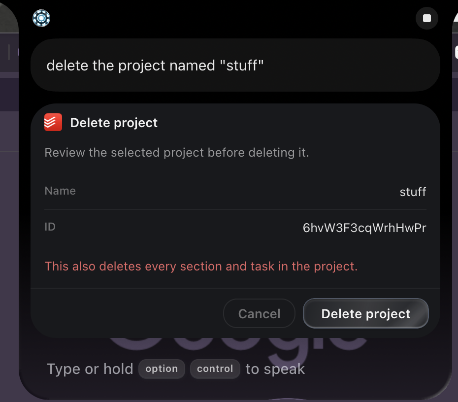

# Todoist integration — 1.0.14

A VoiceOS integration for Todoist powered by Composio OAuth. It enables voice control to manage tasks, projects, sections, and personal labels, monitor productivity stats, and handle account authentication with interactive cards and confirmation dialogs.

## Download & Installation

- **Download Link**: [https://api.voiceos.com/integration-share/GZS8H9CtoVvI/page](https://api.voiceos.com/integration-share/GZS8H9CtoVvI/page)


## Platform and setup

VoiceOS launches the integration with `run.sh` on macOS and `run.cmd` on Windows.
Connect opens the Composio authorization page in your default browser on either platform.

Enter `COMPOSIO_API_KEY` in VoiceOS’s Todoist integration settings; VoiceOS stores
and injects it into the server environment. `.env.example` documents the required
variable. For direct local development with Bun, an ignored `.env` file can
supply it automatically.

## Tools

The integration exposes **18 tools: 15 business tools and 3 account/setup helpers**:

### Account & Setup
- **Connect Todoist** (`connect_account`): opens browser authorization and immediately returns its pending state and link, or verifies a saved active connection.
- **Todoist account** (`connection_status`): Displays the current connection status (active, pending, disconnected, or expired) with an account status card in the notch.
- **Disconnect Todoist** (`disconnect_account`): Unlinks the active Todoist account, revokes access, and clears cached state (requires confirmation).

### Tasks
- **Create task** (`create_task`): Creates a new task with editable name, optional project, section, priority, due date/string, and labels (requires confirmation).
- **Update task** (`update_task`): Updates an existing task's name, priority, due date, project, or labels (requires confirmation).
- **Complete task** (`close_task`): Completes/closes a task; recurring tasks automatically advance to their next occurrence (requires confirmation).
- **Get active tasks** (`get_active_tasks`): Read-only lookup with filters (project, section, label, priority, due date ranges), task ID resolution, and pagination.

### Projects & Sections
- **List Todoist projects** (`list_projects`): Read-only lookup listing projects with pagination.
- **Create project** (`create_project`): Creates a new project with a name and optional description, color, and favorite status (requires confirmation).
- **Delete project** (`delete_project`): Deletes a project along with all nested sections and tasks (requires confirmation).
- **List Todoist sections** (`list_sections`): Read-only lookup of sections, with optional project filtering and pagination.
- **Create section** (`create_section`): Creates a new section within a project (requires confirmation).
- **Delete section** (`delete_section`): Deletes a section and its contained tasks (requires confirmation).

### Labels
- **List Todoist labels** (`list_labels`): Read-only lookup of personal labels with name resolution, limit, and cursor pagination.
- **Create label** (`create_label`): Creates a new personal label with a name and optional color and favorite status (requires confirmation).
- **Update label** (`update_label`): Renames a label or updates color, order, or favorite status (requires confirmation).
- **Delete label** (`delete_label`): Deletes a personal label and removes it from all associated tasks (requires confirmation).

### Productivity
- **Get productivity stats** (`get_productivity_stats`): Read-only lookup returning completed tasks count, daily/weekly goals, and karma.

## Result and Confirmation Cards

All actions use confirmation cards with a Cancel/Action footer. The screenshots show the macOS layout.

| Connect Account | Create Task | Delete Confirmation |
| :---: | :---: | :---: |
|  |  |  |

- **State modifications**: Task, project, section, and label creation share an editable `Name` field followed by a details summary. Updates display the selected entity name and ID alongside requested changes; untouched fields remain unmodified.
- **Destructive actions**: Deletions clearly display Name, ID, and an explicit warning explaining the consequences (e.g. deleting a project also deletes all containing sections and tasks).
- **Read-only lookups**: Return glance cards with structured data without prompting for confirmation.
- **Label operations**: `list_labels` reads labels with optional `limit` and `cursor`. Modifying labels is handled cleanly by dedicated `create_label`, `update_label`, and `delete_label` tools.

## Architecture & Reliability

- **SDK & Protocol Safety**: Built with `@composio/core` (0.28.0) and `@modelcontextprotocol/sdk`. The Composio SDK automatic version check is disabled to ensure stdout contains only valid MCP JSON-RPC protocol messages and prevents upgrade notices from disrupting communication.
- **Synchronous OAuth Handoff & Background Status Notification**: Connect is a short, synchronous browser handoff; it opens browser authorization and immediately returns a pending status with its link rather than blocking VoiceOS or scheduling an orphaned sidebar task. A non-blocking background watcher monitors Composio for browser approval and surfaces a single completion notification once active. Normal task and project writes omit sticky toast notifications to keep the UI clean (UIUC-17).
- **Resilient Recovery**: Stalled pending-link lookups abort safely after 8 seconds while caching the saved pending link, allowing users to resume authorization without lost state.

## Automated tests

From `integrations/todoist/`, run:

```sh
bun install
bun test
```

The repository's existing GitHub Actions workflow runs those commands for this
integration. No API keys, saved authorization, or live Todoist account are needed.

`tests/server.test.ts` starts a disposable copy of the real server and calls it
over MCP using the real Composio SDK. `tests/mock-composio.ts` intercepts every
fetch with local fixtures and rejects unexpected requests. The temporary server
copy redirects only its browser-opening import to a recording stub; the installed
integration and real OAuth state are never loaded or changed. Temporary files and
the child server are cleaned up when the suite finishes.

Coverage includes:

- The fifteen business tools, including separate label creation, updates, and deletion, and the three current
  account/setup helpers. The explicit catalog assertion documents the setup
  helpers separately; it does not imply additional business-tool approval.
- Exact Composio operations and arguments, partial updates, and invalid inputs.
- Action confirmation definitions, read-only confirmation exclusions, result-card limits, empty responses, and
  pagination while retaining full response data.
- Background OAuth success/failure notifications, credential redaction,
  and SDK-wrapped timeouts without repeating writes (per-write toasts removed per UIUC-17).
- MCP stdout remains protocol-only when npm advertises a newer Composio SDK;
  the SDK version check is disabled so upgrade notices cannot break the connection.
- Saved, pending, expired, revoked, disabled, and rejected account states;
  mocked OAuth completion and reuse; concurrent connects; disconnect success,
  unsupported provider revocation, and failure recovery. A stalled pending-link
  lookup aborts after eight seconds and keeps the saved link for recovery.
- Connect is a short, synchronous browser handoff; it returns pending immediately and relies on a non-blocking background watcher to surface completion notifications when browser authorization finishes. Stale or unapproved pending links are safely replaced with fresh sessions on reconnect. Status verification is checked via connection_status without reopening the browser. Concurrent Connect calls share a single authorization attempt; Connect and Disconnect cannot run at the same time.

These offline tests complement manual checks in VoiceOS and Todoist. They verify
notification payloads and confirmation definitions, not their visual rendering.
Mocked OAuth completion also does not verify provider consent or a real token
refresh. There is no live-account test script included or run by CI.
